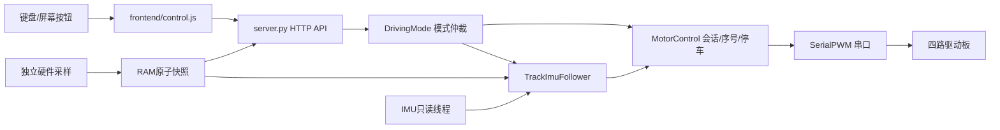

# 代码地图

## 当前控制链

## 后端分类

| 文件 | 作用 |
|---|---|
| server.py | API、静态资源、服务生命周期、控制器装配 |
| driving_mode.py | 手动/自动的单一控制权 |
| motor_control.py | 差速混合、序号、租约、启动助力、串口协议及停车 |
| track_imu_follower.py | 当前v5最终自动目标限幅和侧偏丢线停车 |
| positive_arc_follower.py | 继承的前进差速、全白上下文、倒退与固定角参考 |
| imu_line_follower.py / basic_line_follower.py | 继承的转弯闭环、采样、生命周期与探头处理 |
| route_line_follower.py | 保留的无IMU路线版本；当前未选 |
| imu_heading.py | 7E23欧拉角解析、展开与软件原点 |
| hardware_worker.py / native/ | 分进程GPIO、DHT11与相机采集 |
| readings.py / service.py / parser.py / collectors.py | 缓存读取、被动遥测和系统状态 |
| acquisition.py / experiment_log.py | 温湿度事件与CSV |
| line_trials.py | 后台驾驶日志；当前页面不加载填写弹窗 |
| mission_plan.py / mission_runtime.py | 独立站点任务库，尚未实物commission |
| line_guidance.py / line_calibration.py / line_transition_gate.py | 参考标定、引导与历史判别工具 |

## 页面模块

`app.js`读取传感器与相机；`control.js`负责输入和模式；`vehicle.js`负责指令动画；`heading.js`负责角度和校准；`acquisition.js`负责CSV采集。`trials.js`保留源码但没有被当前index加载。

## 启动入口

`deploy/start_monitor.py`为板上服务启动入口，`deploy/imu_route.json`选择track_imu。只运行`backend/server.py`且不传硬件参数，可在电脑离线预览。

`tools/run_commissioned_mission.py`是另一套任务入口，不是当前控制台自动驾驶。旧80–220速度配置不适用于当前最高20路线。

## 历史与当前

历史基类保留较大的参数，是为了保留已有代码与回退来源；最终生效值必须沿实际继承和装配路径检查。历史源码归档只作查阅，不应整体覆盖当前主程序。每次改动先补相应回归，再在明确的实车版本上验收。
